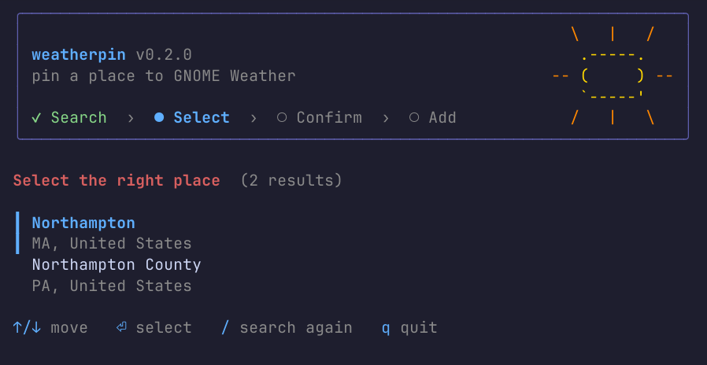

# weatherpin ☀️

[](LICENSE)
[](#prerequisites)

**Pin any place to GNOME Weather — just type its name.**

GNOME Weather's built-in location search can be hit-or-miss. `weatherpin` is a
small, friendly terminal app that finds the place for you, shows you what it
found, and adds it to GNOME Weather. No hunting for latitude and longitude.

<p align="center">
  
</p>

## ✨ Features

- **Search by name.** Type `Northampton, MA`; coordinates are looked up for you.
- **Confirm before anything changes.** Review the match, rename it, or go back.
- **"Did you mean…?"** If a name isn't found (say, a typo), close matches are suggested.
- **Tidy names.** US states are shown as two-letter abbreviations (`Northampton, MA`).
- **Add several in one go.** After each location, add another or quit.
- **Native and Flatpak.** Detects how GNOME Weather is installed and does the right thing.
- **Safe to try.** `--dry-run` runs the whole flow without writing anything.
- **Helpful when something's missing.** `--check` tells you exactly what to install.

## ✅ Prerequisites

| Requirement | Why | Package (Fedora / Debian & Ubuntu / Arch) |
| --- | --- | --- |
| GNOME Weather | The app you're adding places to (native or Flatpak) | `gnome-weather` / `gnome-weather` / `gnome-weather` |
| `bash` 4.0+ | Runs the script | preinstalled on virtually all Linux distros |
| `curl` | Looks places up online | `curl` |
| `jq` | Reads the search results | `jq` |
| `awk` | Converts degrees to radians | `gawk` |
| `gsettings` | Writes to GNOME Weather's settings | `glib2` / `libglib2.0-bin` / `glib2` |
| A UTF-8 terminal, at least 56×22 | Draws the interface | — |

You'll also need an internet connection while searching.

Not sure what you have? Run the built-in check. It lists what's missing and prints the
install command for your distribution:

```bash
weatherpin --check
```
## 🍺 Install Option #1: Homebrew

```bash
brew install e1dred/tap/weatherpin
```

## 🛠️ Install Option #2: Direct from GitHub/GitLab

**Quick start** — run it straight from a clone:

```bash
git clone https://github.com/e1dred/weatherpin.git
cd weatherpin
chmod +x weatherpin
./weatherpin

--or--

git clone https://gitlab.com/e1dred/weatherpin.git
cd weatherpin
chmod +x weatherpin
./weatherpin
```
**Install for your user** — so `weatherpin` works from anywhere:

```bash
install -Dm755 weatherpin ~/.local/bin/weatherpin
```
Make sure `~/.local/bin` is on your `PATH` (most distributions already include it).

## 💻 Usage

```bash
weatherpin                     # start the interactive app
weatherpin "Northampton, MA"   # start with a search already filled in
weatherpin --dry-run           # try everything without changing a thing
```

### 🔣 Keys

| Screen | Key | Action |
| --- | --- | --- |
| Search | `⏎` | Search for what you typed |
| Select | `↑` `↓` / `j` `k` | Move between matches |
| Select | `⏎` | Choose the highlighted match |
| Select | `/` | Search again |
| Confirm | `y` / `⏎` | Add the location |
| Confirm | `e` | Rename how it appears in GNOME Weather |
| Confirm | `n` | Not this one — go back |
| Add another | `a` / `⏎` | Add another location |
| Anywhere | `q` | Quit (`Ctrl-C` also works) |

### 🔀 Options

| Option | Description |
| --- | --- |
| `-c`, `--check` | Check prerequisites and exit |
| `-n`, `--dry-run` | Run the full flow but write nothing and restart nothing |
| `--no-restart` | Add locations but leave GNOME Weather as it is |
| `-h`, `--help` | Show help |
| `-V`, `--version` | Show the version |

Set `NO_COLOR=1` to turn off colors.

### ℹ️ Good to know

- When you finish, GNOME Weather is restarted **once** so your new places show up. It's only
  restarted if it was already running.
- Adding the same place twice is detected and skipped.
- To remove a location, use GNOME Weather's own interface.

## 💡How it works

1. Your search is sent to [OpenStreetMap Nominatim](https://nominatim.org/).
2. If nothing matches, a typo-tolerant search ([Photon](https://photon.komoot.io/)) suggests close matches.
3. You pick and confirm a result; the coordinates are converted to radians.
4. The location is appended to the `locations` key of the `org.gnome.Weather` GSettings schema
   (through `flatpak run --command=gsettings` for Flatpak installs).

## 🛡️ Privacy

Only the text you search for is sent, to Nominatim and, if needed, Photon. Both are
free public services run on OpenStreetMap data; please be kind to them and don't script
bulk lookups. Nothing else leaves your machine, and `weatherpin` keeps no logs or history.

## ⚠️ Troubleshooting

**"UTF-8 locale" fails in `--check`.** Your terminal isn't using UTF-8. Try
`export LC_ALL=C.UTF-8` (or `en_US.UTF-8`) and run again.

**"Terminal too small."** Enlarge the window to at least 56×22. The sun appears at 70+ columns.

**"Couldn't reach the search service."** Check your connection and try again; the public
services occasionally rate-limit or go down.

**A place isn't found.** Add a region or country (`Springfield, IL`), or check the spelling.

**The new location doesn't show up.** Fully quit and reopen GNOME Weather, or run
without `--no-restart`.

## 📜 License

[BSD Zero Clause License (0BSD)](LICENSE) — do whatever you like with it, no attribution required.

## 🫡 Acknowledgments

- `weatherpin` is a **complete rewrite, not a fork**, inspired by
  [crian/gweather-add-loc](https://github.com/crian/gweather-add-loc). That project had the
  idea of adding custom locations to GNOME Weather through GSettings; this one builds an
  interactive, search-driven experience around it.
- Place data © [OpenStreetMap contributors](https://www.openstreetmap.org/copyright),
  served by [Nominatim](https://nominatim.org/) and [Photon](https://photon.komoot.io/).
